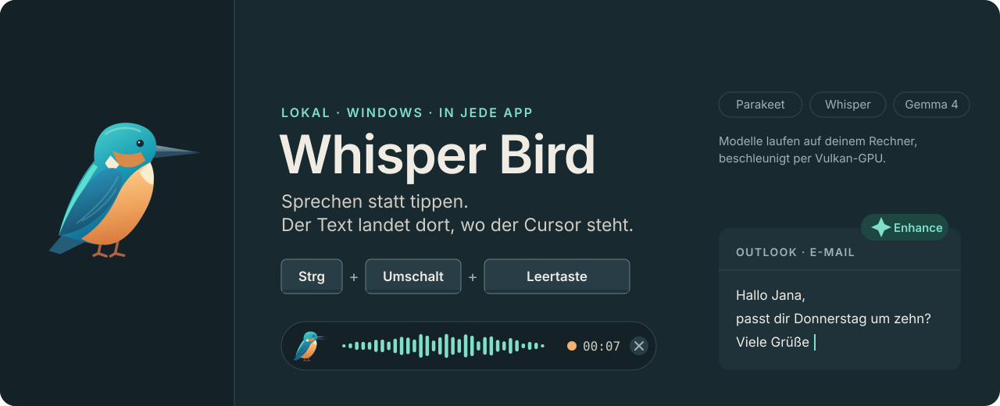
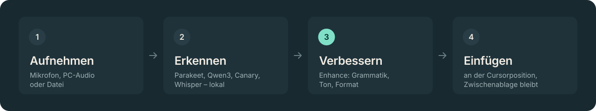

<!-- Hallmark · shape: readme · genre: playful · theme: brand (kingfisher) · system: design.md · art: docs/readme/*.svg, generated by scripts/readme-art.py -->

<p align="center">
  
</p>

<p align="center">
  <b>Lokales Diktieren, Verbessern und Transkribieren für Windows und macOS – in jede App.</b><br>
  <sub>Windows 10/11 · macOS 12+ auf Apple Silicon (Vorschau) · Rust & Tauri 2 · React/TypeScript · Spracherkennung und KI laufen auf deinem Rechner</sub>
</p>

<p align="center">
  <a href="#funktionen">Funktionen</a> ·
  <a href="#installieren">Installieren</a> ·
  <a href="#entwickeln">Entwickeln</a> ·
  <a href="#testen">Testen</a> ·
  <a href="#aufbau">Aufbau</a> ·
  <a href="#danksagungen--lizenzen">Lizenzen</a>
</p>

<br>

## So funktioniert's

Drück <kbd>Strg</kbd> + <kbd>Umschalt</kbd> + <kbd>Leertaste</kbd> (auf dem Mac
<kbd>⌃</kbd> + <kbd>⇧</kbd> + <kbd>Leertaste</kbd>), sprich los, und der Text erscheint dort,
wo der Cursor gerade steht: in Outlook, Slack, VS Code oder jeder anderen App. <kbd>Esc</kbd>
bricht ab.

<p align="center">
  
</p>

<br>

## Funktionen

### Diktieren

| | |
|---|---|
| **Diktat** | Globaler Shortcut (Standard <kbd>Strg</kbd> + <kbd>Umschalt</kbd> + <kbd>Leertaste</kbd>), wahlweise Umschalten, Push-to-talk oder Hybrid. Der Text erscheint an der Cursorposition, <kbd>Esc</kbd> oder ✕ bricht ab. |
| **Overlay** | Verschiebbares Floating Icon: Klick startet das Diktat, Rechtsklick öffnet das Menü, darauf gezogene Dateien werden transkribiert. Während der Aufnahme eine Pille mit Live-Waveform. Nimmt nie den Fokus. |
| **Text bearbeiten** | Markierten Text in jeder App per Shortcut verbessern, kürzen, erweitern, im Ton ändern, als Liste formatieren oder übersetzen – oder eine eigene Anweisung tippen bzw. sprechen. |
| **Wörter** | Custom Words (unscharfe Korrektur und Modell-Vokabular) und Snippets (gesprochener Auslöser → fester Text). |

### Aufnahmen

| | |
|---|---|
| **Meetings** | Mikrofon und/oder PC-Audio (Windows: WASAPI-Loopback, macOS ab 14.6: Core-Audio-Process-Tap), Live-Transkript, danach Sprechererkennung (Sortformer), umbenennbare Sprecher, automatische Notizen, Export als PDF oder Text. Mit beiden Quellen bleiben die Spuren getrennt: Das Mikrofon ist „Ich“ (Lautsprecher-Echo wird mit WebRTC AEC3 abgezogen und Reste herausgefiltert), nur die Gegenseite wird nach Sprechern aufgeteilt. |
| **Dateien** | Audio, Video oder ganze Ordner per Drag & Drop – eine Textdatei pro Aufnahme, im Hintergrund mit Fortschritt. |

### Modelle & Enhance

| | |
|---|---|
| **Spracherkennung** | Parakeet Ultra (Standard), Parakeet v3, Qwen3-ASR 1.7B/0.6B, Canary 1B v2, Parakeet English, Whisper Tiny bis Large v3 – lokal über transcribe.cpp, auf der GPU per Vulkan (Windows) bzw. Metal (Mac). |
| **Enhance** | Grammatik, Zeichensetzung, Füllwörter, Selbstkorrekturen und app-gerechte Formatierung (E-Mail, Chat, Code …). Immer an oder über einen zweiten Shortcut. Fällt bei Fehlern auf den Rohtext zurück. |

Enhance läuft über einen dieser Anbieter:

| Anbieter | Wie |
|---|---|
| **Lokal** | Gemma 4 über llama.cpp (Vulkan bzw. Metal), komplett offline |
| **CLI** | Vorlagen für Claude Code, Codex, Gemini CLI, Pi und Copilot CLI – oder ein eigener Befehl |
| **API** | Jede OpenAI-kompatible Schnittstelle |

### Alltag

| | |
|---|---|
| **Verlauf & Statistik** | Suche, Filter nach Quelle und Datum, Doppelklick kopiert; Wörter, Dauer, gesparte Zeit, Sprachen, 30-Tage-Verlauf. |
| **Komfort** | Zwischenablage bleibt erhalten, Auto-Enter pro App, Töne, Audio-Ducking, Tray-Menü, Autostart, Oberfläche auf Deutsch und Englisch. |

<br>

## Installieren

Unter [**Releases**](https://github.com/CodingEmil/whisper-bird/releases/latest) gibt es
einen Installer (NSIS) und eine portable Zip.

> [!NOTE]
> Die Builds sind nicht signiert, beim ersten Start erscheint deshalb ein SmartScreen-Hinweis.
> Whisper Bird braucht einen Vulkan-fähigen Grafiktreiber (`vulkan-1.dll`). Aktuelle Treiber
> von AMD, NVIDIA und Intel bringen ihn mit.

Updates sucht, lädt und installiert die App selbst.

### macOS (Vorschau)

Die Mac-Version für Apple Silicon entsteht bisher nur per Hand
(Actions → Build → *Run workflow*, das `.dmg` hängt am Lauf) oder lokal, siehe
[Entwickeln](#entwickeln). Sie ist ad hoc signiert, nicht notarisiert:

1. Beim ersten Öffnen blockiert macOS die App. Unter *Systemeinstellungen → Datenschutz &
   Sicherheit* auf **Trotzdem öffnen** klicken.
2. Die Einrichtung fragt nach **Bedienungshilfen** (Shortcuts, Einfügen, markierter Text) und
   dem **Mikrofon**. Meetings mit System-Audio fragen beim ersten Mal nach *Nur Systemaudio
   aufnehmen* (ab macOS 14.6).
3. Nach jedem Update kann macOS die Bedienungshilfen-Freigabe zurücksetzen, weil sich die
   Ad-hoc-Signatur ändert. Die App zeigt das oben als Hinweis an. Abhilfe schafft erst ein
   Apple-Developer-Zertifikat mit Notarisierung.

Noch offen auf dem Mac: Selbst-Update (die App verlinkt die Release-Seite), Intel-Macs nur auf
der CPU, Shortcuts setzen aus, solange eine App „Sichere Eingabe“ aktiv hat (Passwortfelder,
Terminal).

<br>

## Entwickeln

**Windows**, Voraussetzungen (einmalig, z. B. per `winget`): Rust, Bun, CMake, LLVM, Vulkan SDK
und Visual Studio Build Tools mit C++.

```powershell
. .\scripts\env.ps1     # PATH, VULKAN_SDK und LIBCLANG_PATH laden
bun install
bun run tauri dev       # Entwicklungsmodus
bun run tauri build     # Installer (NSIS) unter src-tauri\target\release\bundle
```

**macOS**, Voraussetzungen: Xcode Command Line Tools (`xcode-select --install`), Rust, Bun und
CMake (z. B. `brew install cmake`).

```sh
bun install
bun run tauri dev       # Entwicklungsmodus
bun run tauri build     # Whisper Bird.app und .dmg unter src-tauri/target/release/bundle
```

> [!TIP]
> Der erste Build dauert rund 10 Minuten, weil transcribe.cpp mitgebaut wird (unter Windows
> samt Vulkan-Shadern).

> [!NOTE]
> Im Entwicklungsmodus fragt macOS die Bedienungshilfen für das Terminal bzw. die
> Entwicklungs-Binary ab, nicht für die gebaute App. Nach einem neuen Build kann die Freigabe
> erneut nötig sein.

| Befehl | Wofür |
|---|---|
| `bun run icons` | Icons neu erzeugen |
| `bun run notices` | Lizenzen Dritter neu erzeugen (siehe [unten](#danksagungen--lizenzen)) |
| `python scripts/readme-art.py` | Grafiken dieser README neu erzeugen |

Das Designsystem der Oberfläche steht in [`design.md`](design.md), die Tokens in
[`src/tokens.css`](src/tokens.css).

<br>

## Testen

Nach jedem Patch einmal alles durchlaufen lassen:

```powershell
.\scripts\test.ps1            # alles außer Hardware   (bun run test:all)
.\scripts\test.ps1 -Quick     # ohne Modelle, ~1 Minute (bun run test:quick)
.\scripts\test.ps1 -Hardware  # zusätzlich Mikrofon und System-Audio
```

Auf dem Mac dasselbe mit `scripts/test.sh` (`--quick`, `--hardware`).

| Schritt | Was geprüft wird |
|---|---|
| TypeScript | `tsc --noEmit` |
| Rust-Unit-Tests | `cargo test --lib`: Textbereinigung, Sprecher-Glättung, Mischen, Updates, Einstellungen … |
| UI-Tests | Playwright mit gemockter nativer Schnittstelle (einmalig `bun x playwright install chromium`) |
| End-to-End | Echte Modelle und echtes Audio, siehe unten |
| Hardware | Mikrofon nimmt 2 s auf; bei System-Audio wird die Kennedy-Rede abgespielt, mitgeschnitten und erkannt |

<details>
<summary><b>End-to-End-Tests mit echtem Audio</b></summary>

<br>

Die Tests in `src-tauri/src/e2e/` arbeiten mit echtem Audio:

- **Diktat:** Die Kennedy-Rede (Beispiel aus whisper.cpp) wird wortgenau erkannt (Wortfehlerrate ≤ 10 %).
- **Datei:** Ein deutscher Wikipedia-Artikel (Ogg, 2:34 min) wird in Abschnitten transkribiert, mit Fortschritt und automatischer Spracherkennung.
- **VAD:** Pausen bleiben frei, Rauschen gilt nicht als Sprache.
- **Meeting mit vier Personen:** 5 Minuten aus dem AMI-Meeting ES2004a laufen ein wie vom Mikrofon (Live-Transkript), danach folgen Sprechererkennung und Neutranskription wie in der App. Verglichen wird mit der AMI-Referenz, wer wann spricht: 4 Sprecher, Zuordnung und DER.
- **Deutscher Dialog:** Zwei Sprecher aus der Gesprochenen Wikipedia im Wechsel, mit exakt bekannten Sprecherwechseln. Geprüft wird auch, ob die Texte beim richtigen Sprecher landen.
- **Getrennte Spuren:** Derselbe Dialog, aber ein Sprecher am Mikrofon und einer im PC-Audio, das zusätzlich als Echo ins Mikrofon zurückläuft. Erwartet: „Ich“ und ein Sprecher der Gegenseite, ohne Echo-Text bei „Ich“.
- **Echtes Geräte-Echo:** Vier echte Aufnahmen aus der Microsoft AEC Challenge (PC-Audio und was das Gerätemikrofon davon mithört, bis 600 ms Verzögerung), dazwischen eigene Beiträge gleich laut wie das Echo. Kein Wort der Gegenseite darf bei „Ich“ landen.

Der erste Lauf lädt Testaudio und Sortformer (~180 MB, mit Prüfsumme) nach
`src-tauri\target\test-fixtures`. Bereits installierte Modelle der App werden nur gelesen,
Einstellungen und Verlauf bleiben unberührt. Am Ende stehen die Kennzahlen neben denen des
letzten Laufs, so fällt eine schleichende Verschlechterung auf.

| Variable | Wirkung |
|---|---|
| `$env:WHISPER_ISLAND_TEST_ASR = 'whisper-small'` | Anderes Spracherkennungsmodell testen |
| `$env:PLAYWRIGHT_CHANNEL = 'chrome'` | UI-Tests mit installiertem Chrome statt Chromium |

Lizenzen des Testaudios: AMI Meeting Corpus (CC BY 4.0), Gesprochene Wikipedia
„Bamberger Bierkrieg“ (CC BY-SA 4.0) und „Magic 8 Ball“ (CC BY-SA 3.0), Kennedy-Rede
gemeinfrei, Microsoft AEC Challenge (Nutzungsbedingungen laut Repo). Die Dateien werden
nicht mit ausgeliefert.

</details>

<br>

## Builds per GitHub Actions

Der Workflow [`.github/workflows/build.yml`](.github/workflows/build.yml) baut auf
`windows-latest` den NSIS-Installer und eine portable Zip (Exe + VC++-Runtime-DLLs). Vorher
laufen TypeScript-Prüfung, UI-Tests und Rust-Unit-Tests; schlägt einer fehl, gibt es weder
Dateien noch Release. Die End-to-End-Tests mit Modellen laufen nur lokal.

Bei manuellem Start baut ein zweiter Job auf `macos-latest` die Mac-App als `.dmg` (mit
Rust-Unit-Tests vorab). Sie landet nur als Artifact am Lauf, noch nicht im Release.

| Weg | So geht's |
|---|---|
| **Manuell** | `gh workflow run build.yml` (oder Actions → Build → *Run workflow*). Die Dateien hängen danach als Artifact am Lauf (`gh run download`). |
| **Release** | `git tag v0.2.0 && git push origin v0.2.0` baut mit dieser Versionsnummer und legt ein GitHub Release mit beiden Dateien an. |

<br>

## Aufbau

<details>
<summary><b>Verzeichnisse</b></summary>

<br>

```
src-tauri/src/
  lib.rs          Start, Plugins, Fenster, Hintergrundaufgaben
  dictation.rs    Ablauf Aufnahme → Transkription → Enhance → Einfügen
  hotkeys.rs      Globale Shortcuts (handy-keys), Shortcut-Aufnahme
  asr.rs          transcribe-cpp: Modell laden, VAD-Zerlegung langer Audios
  enhance/        Prompts, llama-server-Verwaltung, CLI- und API-Anbieter
  editmenu.rs     Kontextmenü „Text bearbeiten“
  meeting.rs      Meeting-Aufnahme, Live-Transkript, Diarisierung, Notizen
  files.rs        Datei-/Ordner-Transkription
  insert.rs       Einfügen und Markierung auslesen
  platform/       Zwischenablage, Tastatureingaben, aktive App, Berechtigungen
    macos/        dasselbe für macOS, dazu NSPanel, Ton, Lautstärke, Shell-PATH
  audio/          Mikrofon, Loopback (WASAPI bzw. Process-Tap), Resampler, Decoder, Töne, Ducking
  overlay.rs      Floating Icon / Statuspille
  tray.rs         Tray- und Kontextmenü
  history.rs      Verlauf & Statistiken (SQLite)
src/
  App.tsx, pages/ Einstellungsfenster
  overlay/        Overlay-Fenster
  editmenu/       Kontextmenü-Fenster
```

</details>

| Was | Windows | macOS |
|---|---|---|
| Einstellungen, Verlauf, Modelle, Meetings | `%APPDATA%\dev.emil.whisper-island` | `~/Library/Application Support/dev.emil.whisper-island` |
| Logs | `%LOCALAPPDATA%\dev.emil.whisper-island\logs` | `~/Library/Logs/dev.emil.whisper-island` |

<br>

## Danksagungen & Lizenzen

Audioaufnahme, Hotkeys und Spracherkennung nutzen die MIT-lizenzierten Crates
`handy-recorder`, `handy-keys` und `transcribe-cpp` aus dem
[Handy](https://github.com/cjpais/Handy)-Projekt, das auch als Vorbild für die Mac-Version
diente. Overlay und Kontextmenü sind dort NSPanels über
[tauri-nspanel](https://github.com/ahkohd/tauri-nspanel). Enhance läuft lokal über
[llama.cpp](https://github.com/ggml-org/llama.cpp).

Die Lizenzen aller Modelle, Crates und npm-Pakete stehen in
[`THIRD-PARTY-NOTICES.txt`](THIRD-PARTY-NOTICES.txt). Installer und portable Zip liefern die
Datei mit, in der App öffnet sie **Hilfe → Lizenzen Dritter**. Nach neuen Abhängigkeiten oder
Modellen neu erzeugen:

```powershell
cargo install cargo-about --locked --features cli   # einmalig
bun run notices
```

<br>

<p align="center">
  <br>
  <sub>Whisper Bird · lokal gebaut, lokal gesprochen</sub>
</p>
